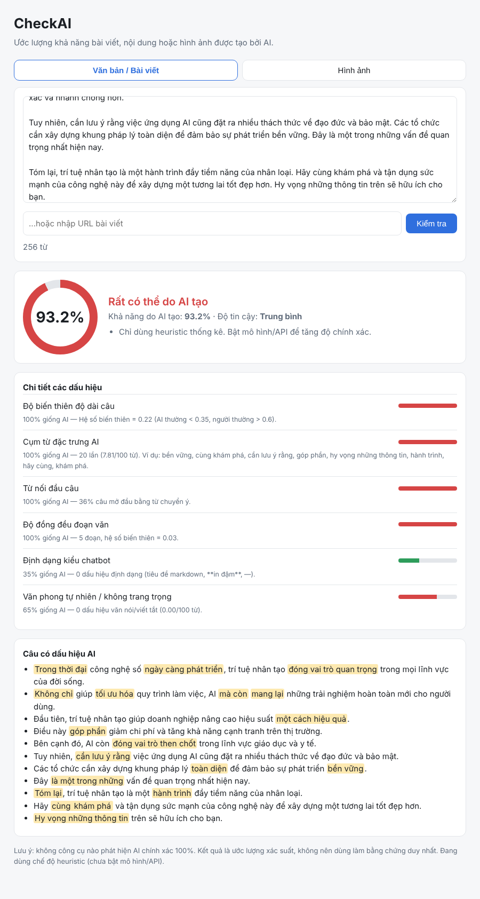

# CheckAI

Ứng dụng web ước lượng **% khả năng một bài viết, đoạn văn bản hoặc hình ảnh được tạo bởi AI**.



## Tính năng

- **Văn bản / bài viết**: dán nội dung hoặc nhập URL bài viết (tự trích nội dung chính). Hỗ trợ tiếng Việt và tiếng Anh.
  Đánh dấu các câu có cụm từ đặc trưng của AI.
- **Tệp Word / PDF**: tải lên `.docx`, `.pdf`, `.txt`, `.md` (tối đa 20MB) để trích nội dung và phân tích như văn bản.
  PDF phải có lớp chữ (PDF ảnh scan chưa được hỗ trợ vì chưa có OCR); tệp `.doc` cũ cần lưu lại thành `.docx`.
- **Hình ảnh**: tải ảnh lên (JPG, PNG, WEBP… tối đa 20MB). Đọc metadata (EXIF, PNG text, XMP/IPTC, C2PA) và phân tích điểm ảnh.
- Mỗi kết quả gồm: **% khả năng do AI**, kết luận, độ tin cậy, và chi tiết từng dấu hiệu.

## Cài đặt & chạy

```bash
pip install -r requirements.txt
streamlit run streamlit_app.py          # giao diện Streamlit, mở http://localhost:8501
# hoặc bản web FastAPI + REST API:
pip install -r requirements-api.txt && uvicorn checkai.api:app --reload   # mở http://localhost:8000
```

## Deploy lên Streamlit Community Cloud

1. Đẩy code lên GitHub (repo này).
2. Vào https://share.streamlit.io → **Create app** → chọn repo, nhánh, và **Main file path** = `streamlit_app.py`.
3. Trong **Advanced settings** chọn Python 3.11 trở lên.
4. (Tuỳ chọn) Dán khoá API vào mục **Secrets** theo mẫu `.streamlit/secrets.toml.example`:
   ```toml
   SAPLING_API_KEY = "..."
   SIGHTENGINE_API_USER = "..."
   SIGHTENGINE_API_SECRET = "..."
   ```
5. Bấm **Deploy**. Streamlit tự cài `requirements.txt`.

> Không nên bật `CHECKAI_LOCAL_MODELS` trên gói miễn phí của Streamlit Cloud: `torch` + mô hình cần vài GB,
> vượt giới hạn bộ nhớ (~1GB). Trên Streamlit Cloud hãy dùng API (Sapling, Sightengine) để tăng độ chính xác.

Chạy test: `pip install -r requirements-dev.txt && pytest`

## Cách hoạt động

### Văn bản
| Dấu hiệu | Ý nghĩa |
|---|---|
| Độ biến thiên độ dài câu (burstiness) | Người viết câu dài ngắn thất thường; AI đều đặn |
| Cụm từ đặc trưng AI | "đóng vai trò quan trọng", "tóm lại", "hãy cùng khám phá", "delve", "it's important to note"… |
| Từ nối đầu câu | AI hay mở câu bằng "Ngoài ra", "Bên cạnh đó", "Moreover"… |
| Độ đồng đều đoạn văn | Đoạn văn AI thường dài bằng nhau |
| Định dạng kiểu chatbot | Tiêu đề markdown, gạch đầu dòng **in đậm**, dấu — |
| Văn phong tự nhiên | Viết tắt, cảm thán, emoticon… là dấu hiệu của người |

Văn bản ngắn (< 150 từ) được kéo về mức trung lập vì thống kê chưa đủ tin cậy.

### Hình ảnh
- **Metadata (bằng chứng mạnh)**: tham số Stable Diffusion/ComfyUI trong PNG, IPTC `trainedAlgorithmicMedia`,
  tên công cụ (Midjourney, DALL·E, Firefly, FLUX…), Content Credentials (C2PA). Có dấu vết → ≥ 95%.
- **EXIF máy ảnh** (hãng, model, thông số chụp, GPS) → giảm khả năng AI.
- **Phân tích điểm ảnh (tín hiệu yếu)**: đỉnh tuần hoàn trong phổ FFT (dấu vết upsampling), mức nhiễu cảm biến,
  kích thước ảnh điển hình của mô hình sinh ảnh. Khi chỉ có các tín hiệu này, kết quả bị giới hạn trong khoảng
  20–80% để tránh kết luận quá chắc chắn.

## Tăng độ chính xác (khuyến nghị)

Heuristic chỉ cho kết quả tham khảo. Để chính xác hơn, bật thêm mô hình hoặc API (điểm được gộp, mô hình chiếm 70%):

| Biến môi trường | Tác dụng |
|---|---|
| `CHECKAI_LOCAL_MODELS=1` | Chạy mô hình Hugging Face cục bộ (cần `pip install -r requirements-ml.txt`) |
| `CHECKAI_TEXT_MODEL` | Mô hình văn bản, mặc định `Hello-SimpleAI/chatgpt-detector-roberta` (tiếng Anh) |
| `CHECKAI_IMAGE_MODEL` | Mô hình ảnh, mặc định `umm-maybe/AI-image-detector` |
| `SAPLING_API_KEY` | API phát hiện văn bản AI của [Sapling](https://sapling.ai) |
| `SIGHTENGINE_API_USER`, `SIGHTENGINE_API_SECRET` | API phát hiện ảnh AI của [Sightengine](https://sightengine.com) |

Với văn bản tiếng Việt, nên dùng một mô hình đa ngôn ngữ (ví dụ fine-tune từ `xlm-roberta`) qua `CHECKAI_TEXT_MODEL`.

## API

```bash
curl -X POST localhost:8000/api/text -H 'Content-Type: application/json' -d '{"text": "..."}'
curl -X POST localhost:8000/api/text -H 'Content-Type: application/json' -d '{"url": "https://..."}'
curl -X POST localhost:8000/api/document -F file=@bai.docx   # hoặc .pdf
curl -X POST localhost:8000/api/image -F file=@anh.jpg
curl localhost:8000/api/health
```

Tài liệu API tương tác: `http://localhost:8000/docs`.

## Lưu ý

Không có công cụ nào phát hiện nội dung AI chính xác 100%. Văn bản đã được người chỉnh sửa, ảnh đã bị xoá metadata
(chụp màn hình, đăng qua mạng xã hội) đều khó phát hiện. Hãy dùng kết quả như một tham khảo, không phải bằng chứng duy nhất.
